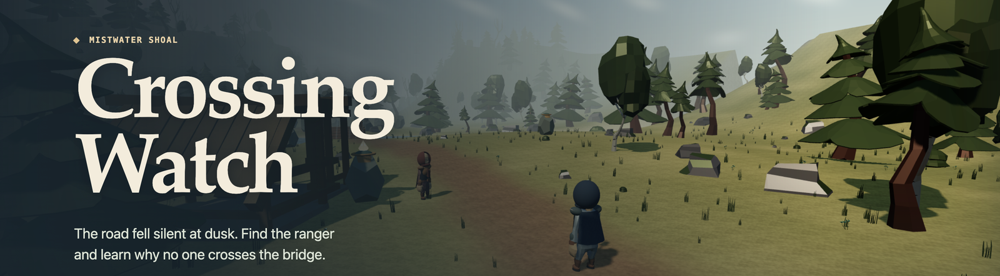
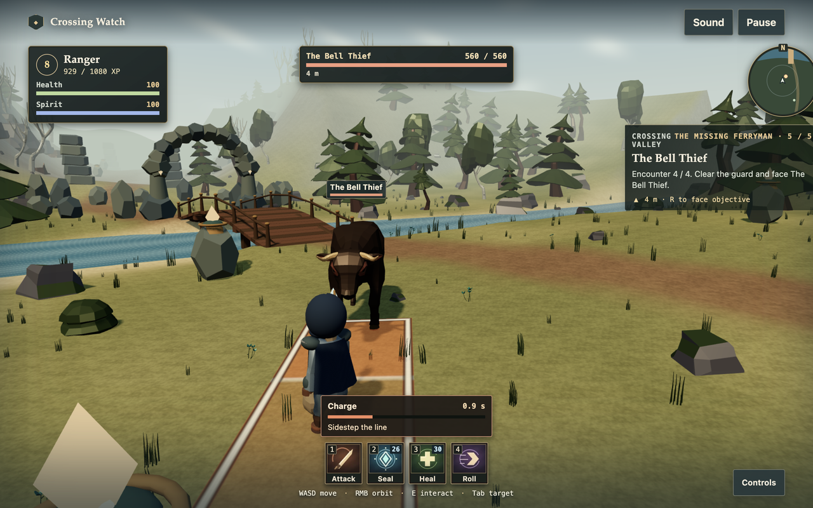
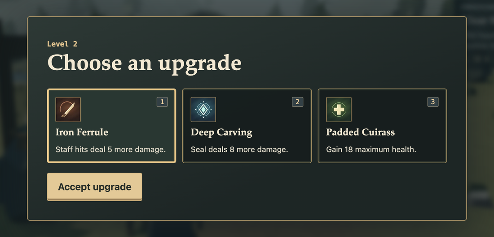
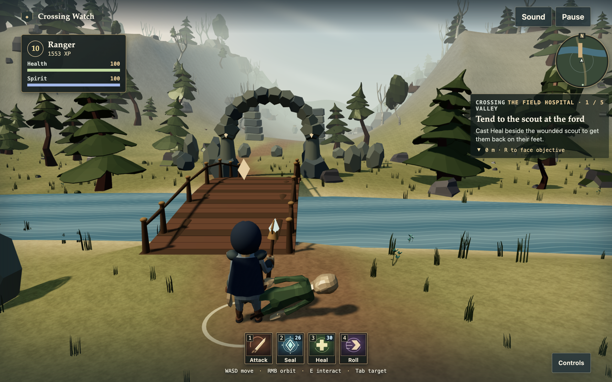
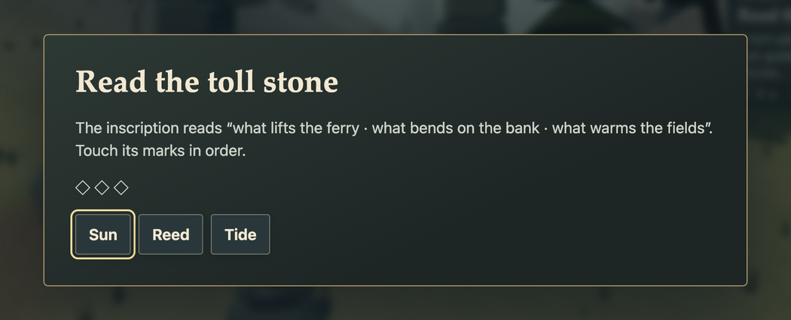

# Crossing Watch

[](https://ndrewndrew.github.io/crossing-watch-rpg/)

**[Play in your browser](https://ndrewndrew.github.io/crossing-watch-rpg/)** · [One-page game brief](https://ndrewndrew.github.io/crossing-watch-rpg/onepage.html)

The ferry bell has gone quiet. Take a crystal staff and follow the road to Mira's camp. Lighting the waybeacons will get you across the river. What happened to the ferryman takes a little longer to uncover.

Crossing Watch is a single-player, third-person RPG with MMO-style target selection. It runs in a WebGL 2 browser with keyboard and mouse or touch controls. Checkpoints save in the same browser. In two automated full runs, a melee build finished in 33 minutes and a survival build in 58.

## Read the fight



The Bell Thief gives away its charge before it moves. Step sideways out of the marked lane and you can save your roll for the next attack. Casters need a different answer. When a violet thread connects a caster to a wounded ally, target the caster and use **Seal** to interrupt the heal.

Each staff hit restores **4 Spirit**. Seal costs 26. A basic Heal costs 30. If you interrupt with only 30 Spirit left, you'll have to earn more before you can heal.

## Build your ranger



Pick one of three cards at each level from 2 through 10. **Iron Ferrule** adds 5 damage to each staff hit. Pair it with **Steady Rhythm** later to land those hits more often. For a caster-hunter, **Long Reach** lets you interrupt from farther away and **Echoing Seal** pays back Spirit when you break a spell. Select a card, then confirm with **Accept upgrade**.

## Beyond the bridge

The first two chapters take you through the waybeacons, the Shoal Warden and the ash shrines. After the Ash Sentinel falls, return to the ferry for **nine field orders and 45 assignments**. Each order follows a local story across several encounters.



**The Field Hospital.** Heal the scout at the ford, then cover their retreat. Later in the same order you'll carry dressings across the river and hold the surgeon's tent.

**The Missing Ferryman.** The toll stone records its code in river lore. Read the inscription and touch the marks in order. The next leg sends you back to the landing to bring the brass bell home.



## Controls

| Action | Keyboard and mouse |
| --- | --- |
| Move, orbit, zoom | WASD or arrow keys, right-drag, mouse wheel |
| Face the objective, interact | R, E |
| Select an enemy | Tab or click |
| Toggle auto-attack, strike once | 1, F |
| Seal / Heal / Roll | 2 / 3 / 4 (Space also rolls) |
| Choose a talent | Click a card or press 1–3, then click **Accept upgrade** |

On touchscreens, move with the joystick, drag the world to orbit, and tap an enemy to target it.

## Run locally

Use Node.js 22.12 or later.

```sh
npm ci
npm run dev
```

The game uses TypeScript, Three.js and Vite. Run `npm test` for the gameplay tests and `npm run build` to produce the static site in `dist/`.

## Credits

Models and skeletal animations by Quaternius (CC0). Camera, terrain, foliage, shadows and combat rendering use MIT-licensed code by Levy Street. [Asset credits](public/ART-CREDITS.txt) · [Levy Street license](public/LICENSE-LEVY-STREET.txt) · [Three.js license](public/LICENSE-THREE.txt)
